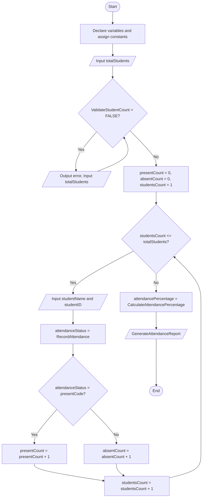

# PROG101 Assignment 1 - Student Attendance Monitoring System

> This is a **logical design** assignment. It contains an algorithm, pseudocode, a Flowgorithm flowchart design, modules and sample scenarios. It contains **no source code**, as the brief requires.

## 1. Project Description
A proposed logical design for a simple Student Attendance Monitoring System. A teacher or class representative enters the class size, records each student as Present (P) or Absent (A), and receives a summary with the number present, number absent and the class attendance percentage.

## 2. Project Objectives
- Apply computational thinking (decomposition, pattern recognition, abstraction, algorithm design) to an attendance-recording challenge.
- Design a step-by-step algorithm, pseudocode and a Flowgorithm flowchart that match each other.
- Demonstrate input, processing, output, decisions, repetition, modular design and functions.
- Show how Open Source Software and Digital Public Goods principles could support SDG 4: Quality Education.

## 3. Problem Description
Recording attendance by hand can be slow, can contain counting or arithmetic mistakes, and makes it harder to produce a quick summary. This project proposes a logical solution to that challenge. It does not claim that every school, college or university in Sierra Leone has this problem, and it does not rely on any survey or statistics.

## 4. Proposed Solution
A validated, loop-based process: validate the class size (1 to 100), process each student in turn, validate each attendance entry (only P or A), update present and absent counters, calculate the percentage and display a summary.

## 5. Algorithm
1. Start the system.
2. Display a welcome message, declare variables and assign the fixed values.
3. Ask for the total number of students.
4. While the number is invalid (below 1 or above 100), show an error and ask again.
5. Set presentCount and absentCount to 0.
6. For each student from 1 to totalStudents: read studentName and studentID; read attendanceStatus and repeat until it is P or A; if P add 1 to presentCount, otherwise add 1 to absentCount.
7. Calculate attendancePercentage = (presentCount x 100) / totalStudents.
8. Display the summary (total, present, absent, percentage, status against a 75% target) and a thank-you message.
9. End the system.

## 6. Pseudocode
```text
// PROG101 - Student Attendance Monitoring System (design only, no source code)

// ================= MAIN PROGRAM =================
START
    OUTPUT "Welcome to the Student Attendance Monitoring System."
    // --- Declarations ---
    DECLARE totalStudents, studentsCount, presentCount, absentCount AS Integer
    DECLARE minStudents, maxStudents, attendanceTarget, studentID AS Integer
    DECLARE studentName, attendanceStatus, presentCode, absentCode AS String
    DECLARE attendancePercentage AS Real
    // --- Fixed values (treated as constants: assigned once, never changed) ---
    SET minStudents = 1
    SET maxStudents = 100
    SET attendanceTarget = 75
    SET presentCode = "P"
    SET absentCode = "A"
    
    // --- Step 1: get and validate the class size ---
    OUTPUT "Enter the total number of students in the class (1 to 100): "
    INPUT totalStudents
    WHILE ValidateStudentCount(totalStudents, minStudents, maxStudents) = FALSE DO
        OUTPUT "Invalid student count. Enter a whole number from 1 to 100."
        INPUT totalStudents
    END WHILE
    
    // --- Step 2: initialise counters ---
    SET presentCount = 0
    SET absentCount = 0
    
    // --- Step 3: process every student (loop runs exactly totalStudents times) ---
    FOR studentsCount = 1 TO totalStudents STEP 1 DO
        OUTPUT "Student " & studentsCount & " of " & totalStudents
        OUTPUT "Enter student name: "
        INPUT studentName
        OUTPUT "Enter student ID: "
        INPUT studentID
        SET attendanceStatus = RecordAttendance(presentCode, absentCode)
        // Module: CountAttendance (decision + counter update)
        IF attendanceStatus = presentCode THEN
            SET presentCount = presentCount + 1
            OUTPUT studentName & " (" & studentID & ") marked PRESENT"
        ELSE
            SET absentCount = absentCount + 1
            OUTPUT studentName & " (" & studentID & ") marked ABSENT"
        END IF
    END FOR
    
    // --- Step 4: calculate and report ---
    SET attendancePercentage = CalculateAttendancePercentage(presentCount, totalStudents)
    CALL GenerateAttendanceReport(totalStudents, presentCount, absentCount, attendancePercentage, attendanceTarget)
    OUTPUT "Attendance session complete."
END

// ================= MODULES (FUNCTIONS) =================

FUNCTION ValidateStudentCount(count AS Integer, minStudents AS Integer, maxStudents AS Integer) RETURNS Boolean
    DECLARE isValid AS Boolean
    IF count >= minStudents AND count <= maxStudents THEN
        SET isValid = TRUE
    ELSE
        SET isValid = FALSE
    END IF
    RETURN isValid
END FUNCTION

FUNCTION RecordAttendance(presentCode AS String, absentCode AS String) RETURNS String
    DECLARE status AS String
    OUTPUT "Enter attendance status (P = Present, A = Absent): "
    INPUT status
    WHILE status != presentCode AND status != absentCode DO
        OUTPUT "Invalid entry. Enter P for Present or A for Absent."
        INPUT status
    END WHILE
    RETURN status
END FUNCTION

FUNCTION CalculateAttendancePercentage(present AS Integer, total AS Integer) RETURNS Real
    DECLARE percentage AS Real
    SET percentage = (present * 100) / total
    RETURN percentage
END FUNCTION

FUNCTION GenerateAttendanceReport(total AS Integer, present AS Integer, absent AS Integer, percentage AS Real, target AS Integer)
    OUTPUT "===== ATTENDANCE SUMMARY ====="
    OUTPUT "Total students: " & total
    OUTPUT "Students present: " & present
    OUTPUT "Students absent: " & absent
    OUTPUT "Attendance percentage: " & percentage & "%"
    IF percentage >= target THEN
        OUTPUT "Status: Attendance target met"
    ELSE
        OUTPUT "Status: Below target - follow-up recommended"
    END IF
    OUTPUT "Thank you. Attendance has been recorded successfully."
END FUNCTION
```
See `pseudocode/pseudocode.txt` for the same text as a file.

## 7. Flowchart Documentation
The main flowchart and the function flowcharts are built in Flowgorithm (file: `flowchart/StudentAttendance.fprg`, to be added after it is built). Screenshots are stored in `screenshots/`. A Mermaid version of the main flow is below.



## 8. Functional Modules
| Module / Function | Purpose | Returns |
|---|---|---|
| ValidateStudentCount(count, minStudents, maxStudents) | Checks the class size is within range | Boolean |
| RecordAttendance(presentCode, absentCode) | Reads status and repeats until P or A | String |
| CountAttendance (decision block in main) | Updates presentCount or absentCount | n/a |
| CalculateAttendancePercentage(present, total) | Applies the percentage formula | Real |
| GenerateAttendanceReport(total, present, absent, percentage, target) | Displays the summary | none |

## 9. Expected Outputs
| Scenario | Total | Present | Absent | Percentage |
|---|---|---|---|---|
| Normal recording | 5 | 4 | 1 | 80% |
| Most present | 20 | 17 | 3 | 85% |
| Some absent | 8 | 5 | 3 | 62.5% |
| Invalid attendance entry (X then P) | 4 | 3 | 1 | 75% |
| Invalid student count (0, -3, 101 rejected; 4 accepted) | 4 | 2 | 2 | 50% |
| All present | 6 | 6 | 0 | 100% |
| All absent | 5 | 0 | 5 | 0% |

Attendance Percentage = (Number of Students Present / Total Number of Students) x 100

## 10. SDG Alignment
Primary: **SDG 4 - Quality Education**. Secondary (supporting): SDG 16, Target 16.6 (effective, accountable and transparent institutions).

## 11. Open-Source Justification
Open licensing lets schools adopt, inspect, translate and improve the design at no licence cost, and lets students, teachers and developers contribute. A permissive OSI-approved licence such as MIT is a suggested option (see LICENSE).

## 12. Digital Public Goods Justification
The design could work towards the Digital Public Goods Standard through open licensing, clear documentation, privacy by design, platform independence and relevance to SDG 4. **It is not an officially recognised Digital Public Good.**

## 13. Repository Structure
```text
PROG101_Assignment1_StudentName_StudentID/
|-- README.md
|-- LICENSE
|-- report/        (final report PDF and DOCX)
|-- algorithm/     (algorithm.md)
|-- pseudocode/    (pseudocode.txt)
|-- flowchart/     (StudentAttendance.fprg, exported images)
|-- screenshots/   (evidence screenshots)
```

## 14. References
See the Harvard reference list in the report.
